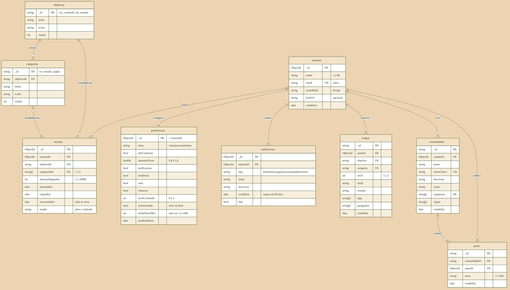

# Banco de dados do Ikai (aplicativo)

Banco **MongoDB 7**, base `ikai`, com **9 coleções**. O banco recusa sozinho dados fora das regras (validação de esquema), e a API em Node.js (`backend/`) expõe as rotas. Esta é a primeira versão do banco do **aplicativo**; o site continua sem banco (o e-mail vai direto ao EmailJS).

## 1. Diagrama entidade-relacionamento



O código-fonte do diagrama está em [`der.mmd`](der.mmd) (Mermaid).

### Como o modelo do relatório virou MongoDB

O relatório técnico do app propõe seis entidades (Figura 3). Todas existem, com estas adaptações:

| Entidade do relatório | Coleção | O que mudou |
|---|---|---|
| USUARIO | `usuarios` | `id_usuario` virou `_id`; `senha_hash` virou `senhaHash` (bcrypt); `foto_url` virou `fotoUrl`, opcional e ainda sem rota. |
| OBJETIVO | `objetivos` | O `_id` é o texto do catálogo (`estudar`). Gravado a partir de `src/catalogo.js`. |
| CATEGORIA | `categorias` | O `_id` é o texto do catálogo (`estudar_ingles`); `objetivoId` aponta para o objetivo. |
| SESSAO | `sessoes` | **Até 5 categorias** por sessão (`categoriaIds`), como no app atual, em vez de uma só. Tem `expiraEm`, calculado pelo servidor. |
| PREFERENCIA_USUARIO | `preferencias` | O `_id` é o id do usuário (relação 1 para 1). Somam-se campos do app atual: `nivelConteudo`, `iaAutorizada` e `metaDiariaMin`. |
| NOTIFICACAO | `notificacoes` | Igual ao relatório, com `tipo` limitado a 4 valores e expiração automática em 90 dias. |

Além das seis, o banco já guardava `artigos`, `comunidades` e `posts` (conteúdo escrito pelos usuários), que agora também têm validação.

O MongoDB não tem chave estrangeira. As ligações (`FK` no diagrama) são conferidas pela API e, quando possível, pelo próprio banco (ver seção 4).

## 2. Dicionário de dados

Tipos do MongoDB. **Obr.** = obrigatório.

### `usuarios`
| Campo | Tipo | Obr. | Regra |
|---|---|---|---|
| `_id` | ObjectId | sim | Chave primária. |
| `nome` | string | sim | 2 a 80 caracteres. |
| `email` | string | sim | Formato de e-mail, até 120 caracteres, **único**. |
| `senhaHash` | string | sim | Hash bcrypt. A senha nunca é guardada. |
| `fotoUrl` | string ou nulo | não | Até 300 caracteres. |
| `criadoEm` | date | sim | |

### `objetivos`
| Campo | Tipo | Obr. | Regra |
|---|---|---|---|
| `_id` | string | sim | `ver_conteudo`, `ler` ou `estudar`. |
| `titulo` | string | sim | Até 40 caracteres. |
| `icone` | string | sim | Nome do `Icons.*` do Flutter. |
| `ordem` | int | sim | 1 a 99. |

### `categorias`
| Campo | Tipo | Obr. | Regra |
|---|---|---|---|
| `_id` | string | sim | Uma das 30 categorias do catálogo (ex.: `estudar_ingles`). |
| `objetivoId` | string | sim | Aponta para `objetivos._id`. |
| `titulo` | string | sim | Até 60 caracteres. |
| `icone` | string | sim | |
| `ordem` | int | sim | 1 a 99. |

Catálogo: Ver conteúdo (6 categorias), Ler (12) e Estudar (12).

### `sessoes`
| Campo | Tipo | Obr. | Regra |
|---|---|---|---|
| `_id` | ObjectId | sim | Chave primária. |
| `usuarioId` | ObjectId | sim | Aponta para `usuarios._id`. |
| `objetivoId` | string | sim | Aponta para `objetivos._id`. |
| `categoriaIds` | array de string | sim | 1 a 5 itens, sem repetição, todos do mesmo objetivo. |
| `duracaoSegundos` | int | sim | 1 a 10.800 (RN01: de 1 segundo a 3 horas). |
| `iniciadaEm` | date | sim | Hora do servidor. |
| `expiraEm` | date | sim | `iniciadaEm` + duração. O relógio do aparelho não prolonga a sessão. |
| `encerradaEm` | date ou nulo | não | Nulo enquanto ativa; ao expirar recebe o valor de `expiraEm`. |
| `estado` | string | sim | `ativa` ou `expirada`. |

### `preferencias`
| Campo | Tipo | Obr. | Padrão | Regra |
|---|---|---|---|---|
| `_id` | ObjectId | sim | | É o id do usuário. |
| `tema` | string | não | `sistema` | `claro`, `escuro` ou `sistema`. |
| `altoContraste` | bool | não | `false` | |
| `tamanhoTexto` | número | não | `1` | De 0,8 a 1,4 (limites do app). |
| `notificacoes` | bool | não | `false` | Desligadas por padrão. |
| `lembretes` | bool | não | `false` | |
| `sons` | bool | não | `false` | |
| `vibracao` | bool | não | `false` | |
| `nivelConteudo` | int | não | `0` | 0 (todos) a 3. |
| `iaAutorizada` | bool ou nulo | não | `null` | Nulo: a pessoa ainda não respondeu. |
| `metaDiariaMin` | int ou nulo | não | `null` | 1 a 1.440 minutos; nulo desliga a meta. |
| `atualizadoEm` | date | sim | | |

Quem nunca mexeu nas configurações não tem documento: a API devolve os padrões acima.

### `notificacoes`
| Campo | Tipo | Obr. | Regra |
|---|---|---|---|
| `_id` | ObjectId | sim | Chave primária. |
| `usuarioId` | ObjectId | sim | Aponta para `usuarios._id`. |
| `tipo` | string | sim | `lembrete`, `conquista`, `comunidade` ou `sistema`. |
| `titulo` | string | sim | 1 a 80 caracteres. |
| `descricao` | string | sim | Até 300 caracteres (pode ser vazia). |
| `criadaEm` | date | sim | Some sozinha depois de 90 dias. |
| `lida` | bool | sim | |

### `artigos`, `comunidades` e `posts`
Conteúdo dos usuários (já existiam). Campos principais: `artigos` (`_id`, `autorId`, `autorNome`, `objetivo`, `categoria`, `nivel` 1 a 3, `titulo` 5 a 100, `resumo` 10 a 200, `tags` até 5, `paragrafos`, `criadoEm`); `comunidades` (`_id`, `criadorId`, `nome` 3 a 40, `nomeChave` único, `descricao` 10 a 140, `icone`, `categorias` até 5, `regras` até 6, `criadoEm`); `posts` (`_id`, `comunidadeId`, `autorId`, `autorNome`, `texto` 3 a 500, `criadoEm`).

## 3. Índices

| Coleção | Índice | Para quê |
|---|---|---|
| `usuarios` | `email_1` (único) | Não repetir e-mail; achar a conta no login. |
| `categorias` | `por_objetivo` | Listar as categorias de um objetivo em ordem. |
| `sessoes` | `historico_do_usuario` | Histórico da pessoa, da mais recente para a mais antiga. |
| `sessoes` | `uma_sessao_ativa` (único parcial, só onde `estado = ativa`) | **O banco impede duas sessões ativas do mesmo usuário**, mesmo com pedidos simultâneos. |
| `notificacoes` | `caixa_do_usuario` | Caixa de entrada, da mais recente para a mais antiga. |
| `notificacoes` | `nao_lidas` | Contar as não lidas. |
| `notificacoes` | `expira_em_90_dias` (TTL) | Apagar notificações com mais de 90 dias (o MongoDB confere a cada 60 s). |
| `artigos`, `comunidades`, `posts` | os da versão anterior | Listagens e autoria. |

## 4. Regras de integridade

| Regra | Onde é garantida |
|---|---|
| Duração da sessão de 1 a 10.800 s (RN01) | Banco (esquema) e API. |
| Categoria pertence ao objetivo (RN04) | API (consulta a `categorias`). O banco confere que o id existe no catálogo. |
| Uma sessão ativa por usuário | Banco (índice único parcial). A API responde 409. |
| E-mail único | Banco (índice) e API (409). |
| Senha só como hash | API (bcrypt); o esquema exige um texto de hash. |
| Tipo de notificação, tema, tamanho do texto, nível | Banco (esquema) e API. |
| Sessão expirada quando o tempo acaba | API: vencidas são marcadas ao consultar, pelo relógio do servidor. |
| Limite de 200 notificações guardadas | API (429). |
| Excluir a conta apaga sessões, notificações, preferências, artigos, comunidades e mensagens | API (`DELETE /meus-dados`). |

A validação usa o nível `moderate`: documentos antigos que já estavam no banco não bloqueiam atualizações, mas tudo que entra de novo é conferido. Um banco da versão anterior é atualizado sozinho na primeira conexão, sem perder dados (há teste para isso).

## 5. Como rodar

Pré-requisitos: Node 20 ou mais novo e um MongoDB (local ou Atlas).

```bash
cd backend
npm install
cp .env.example .env        # preencha MONGODB_URI, MONGODB_DB e JWT_SECRET
npm run db:init             # cria coleções, regras, índices e o catálogo (pode repetir)
npm run db:demo             # opcional: dados de exemplo (ana@exemplo.com / senha-demo-123)
npm start                   # API em http://localhost:3000
npm test                    # 60 testes contra um MongoDB de verdade
```

O servidor também prepara o banco ao iniciar, então `db:init` só é necessário para criar tudo antes de subir a API.

## 6. Rotas do banco

Todas exigem `Authorization: Bearer <token>` (o token vem de `POST /auth/login`).

| Rota | Função | Retornos |
|---|---|---|
| `GET /objetivos` | Objetivos com suas categorias. | 200 |
| `GET /objetivos/:id/categorias` | Categorias de um objetivo. | 200, 404 |
| `POST /sessoes` | Começa uma sessão. | 201, 400, 409 |
| `GET /sessoes/ativa` | Sessão em andamento, com o tempo restante. | 200, 404 |
| `GET /sessoes/ultima` | Última escolha, para sugerir na próxima vez. | 200, 404 |
| `GET /sessoes?limite=&antes=` | Histórico, da mais recente para a mais antiga. | 200, 400 |
| `GET /sessoes/resumo?dias=` | Análise de desempenho: tempo por dia, objetivo e categoria. | 200 |
| `GET /sessoes/:id` | Uma sessão. | 200, 404 |
| `GET /preferencias` | Preferências (ou os padrões). | 200 |
| `PATCH /preferencias` | Muda só o que foi enviado. | 200, 400 |
| `DELETE /preferencias` | Volta ao padrão. | 204 |
| `GET /notificacoes?lida=&limite=` | Caixa de entrada e total de não lidas. | 200 |
| `POST /notificacoes` | Cria uma notificação. | 201, 400, 429 |
| `PATCH /notificacoes/:id` | Marca como lida ou não lida. | 200, 400, 404 |
| `POST /notificacoes/ler-todas` | Marca todas como lidas. | 200 |
| `DELETE /notificacoes/:id` | Apaga uma. | 204, 404 |
| `DELETE /notificacoes` | Limpa a caixa. | 204 |

Sem token, qualquer uma responde `401`. As rotas de login, artigos, comunidades, mensagens e IA continuam como antes.

### Exemplos reais (banco com dados de exemplo)

**Começar uma sessão**

```http
POST /sessoes
{"objetivo": "estudar", "categorias": ["estudar_ingles", "estudar_historia"], "duracaoSegundos": 1800}
```

Resposta `201`:

```json
{
  "id": "6af73d8dcef7efd13b2dccc8",
  "objetivo": "estudar",
  "categorias": [
    "estudar_ingles",
    "estudar_historia"
  ],
  "duracaoSegundos": 1800,
  "estado": "ativa",
  "iniciadaEm": "2026-11-13T16:40:45.244Z",
  "expiraEm": "2026-11-13T17:10:45.244Z",
  "encerradaEm": null,
  "restanteSegundos": 1800
}
```

**Outra sessão com uma em andamento**

```http
POST /sessoes
{"objetivo": "ler", "categorias": ["ler_distopia"], "duracaoSegundos": 600}
```

Resposta `409`:

```json
{
  "erro": "Você já tem uma sessão em andamento. Ela termina em 1800 s."
}
```

**Categoria de outro objetivo**

```http
POST /sessoes
{"objetivo": "ler", "categorias": ["estudar_ingles"], "duracaoSegundos": 600}
```

Resposta `400`:

```json
{
  "erro": "Há categoria que não pertence ao objetivo escolhido."
}
```

**Duração fora do limite**

```http
POST /sessoes
{"objetivo": "ler", "categorias": ["ler_distopia"], "duracaoSegundos": 20000}
```

Resposta `400`:

```json
{
  "erro": "A duração deve ficar entre 1 segundo e 3 horas."
}
```

**Análise de desempenho (7 dias)**

```http
GET /sessoes/resumo?dias=7
```

Resposta `200`:

```json
{
  "dias": 7,
  "desde": "2026-11-06",
  "sessoes": 5,
  "segundos": 8100,
  "porObjetivo": [
    {
      "objetivo": "estudar",
      "sessoes": 3,
      "segundos": 5400
    },
    {
      "objetivo": "ler",
      "sessoes": 1,
      "segundos": 1800
    },
    {
      "objetivo": "ver_conteudo",
      "sessoes": 1,
      "segundos": 900
    }
  ],
  "categoriasMaisUsadas": [
    {
      "categoria": "estudar_historia",
      "titulo": "História",
      "sessoes": 2
    },
    {
      "categoria": "estudar_ingles",
      "titulo": "Inglês",
      "sessoes": 2
    },
    {
      "categoria": "estudar_filosofia",
      "titulo": "Filosofia",
      "sessoes": 1
    },
    {
      "categoria": "ler_distopia",
      "titulo": "Distopia",
      "sessoes": 1
    },
    {
      "categoria": "ver_cientifico",
      "titulo": "Científico",
      "sessoes": 1
    }
  ],
  "porDia": [
    {
      "dia": "2026-11-10",
      "segundos": 1800
    },
    {
      "dia": "2026-11-11",
      "segundos": 1200
    },
    {
      "dia": "2026-11-12",
      "segundos": 2400
    },
    {
      "dia": "2026-11-13",
      "segundos": 2700
    }
  ]
}
```

**Preferências (parcial)**

```http
PATCH /preferencias
{"tema": "escuro", "tamanhoTexto": 1.3}
```

Resposta `200`:

```json
{
  "tema": "escuro",
  "altoContraste": false,
  "tamanhoTexto": 1.3,
  "notificacoes": true,
  "lembretes": false,
  "sons": false,
  "vibracao": false,
  "nivelConteudo": 2,
  "iaAutorizada": null,
  "metaDiariaMin": 90,
  "atualizadoEm": "2026-11-13T16:40:45.273Z"
}
```

**Preferência inválida**

```http
PATCH /preferencias
{"tamanhoTexto": 2}
```

Resposta `400`:

```json
{
  "erro": "O tamanho do texto deve ficar entre 0,8 e 1,4."
}
```

**Caixa de notificações**

```http
GET /notificacoes
```

Resposta `200`:

```json
{
  "naoLidas": 1,
  "itens": [
    {
      "id": "6af73d78270b674b352d52d2",
      "tipo": "lembrete",
      "titulo": "Hora de uma pausa",
      "descricao": "Levante, beba água e olhe pela janela.",
      "criadaEm": "2026-11-13T14:40:24.039Z",
      "lida": false
    },
    {
      "id": "6af73d78270b674b352d52d1",
      "tipo": "conquista",
      "titulo": "Meta diária cumprida",
      "descricao": "Você ficou dentro dos 90 minutos de ontem.",
      "criadaEm": "2026-11-12T20:40:24.039Z",
      "lida": true
    }
  ]
}
```

**Sem login**

```http
GET /sessoes
```

Resposta `401`:

```json
{
  "erro": "Entre na sua conta."
}
```

## 7. Consultas úteis no `mongosh` (depuração)

```js
use ikai
db.getCollectionNames()                                   // as 9 coleções
db.sessoes.find({ estado: "ativa" })                       // quem está em sessão agora
db.sessoes.aggregate([                                    // tempo total por objetivo
  { $group: { _id: "$objetivoId", segundos: { $sum: "$duracaoSegundos" } } }
])
db.categorias.find({ objetivoId: "estudar" }).sort({ ordem: 1 })
db.notificacoes.find({ lida: false })
db.getCollectionInfos({ name: "sessoes" })[0].options.validator   // regras do banco
db.sessoes.getIndexes()
```

## 8. O que ainda não está pronto

- **O aplicativo ainda não consome estas rotas.** Hoje ele guarda a última sessão, as preferências e as notificações no aparelho (`shared_preferences` e memória). O próximo passo é trocar essas leituras e gravações por chamadas à API, com o aparelho como reserva sem rede.
- Biblioteca pessoal (pastas), uso diário e combinados com a Ik AI continuam só no aparelho, de propósito (privacidade). Se a equipe quiser sincronizar, viram novas coleções.
- `fotoUrl` existe no esquema, mas ainda não há rota para enviar foto.
- Não há rotina de backup nem monitoramento. Em produção, use um MongoDB gerenciado (por exemplo, Atlas) com backup ligado.
